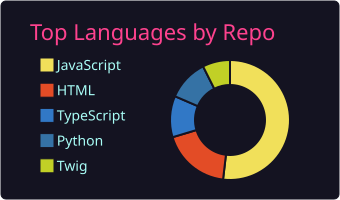
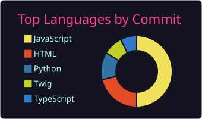
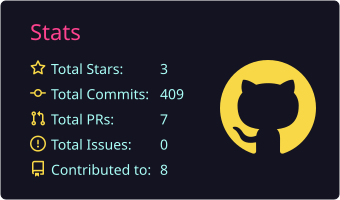

<h1 align="center">Hi, I'm Cristobal Hiza</h1>
<h3 align="center">RevOps & GTM Engineer · Automation & AI — Santiago, Chile 🇨🇱</h3>

<a href="#english">English</a> · <a href="#español">Español</a>

<h2 id="english">🌐 English</h2>

I build the systems behind revenue teams: CRM implementations, outbound pipelines, workflow automation and the AI agents that run them. My latest role is **RevOps & GTM Engineer at Saravá**, where most of the job turned into development: n8n flows, HubSpot setups, B2B lead gen and Claude Code skills and plugins. I also build web projects with WordPress/WooCommerce and React.

- ⚙️ **RevOps / GTM:** HubSpot implementations, n8n automations, outbound with Apollo, Clay, Instantly and Prosp.
- 🤖 **AI agents:** skills and plugins for Claude Code, local LLMs (Ollama).
- 🛒 **Web:** WooCommerce and WordPress with Timber v2, Tailwind and Alpine; React and Next.js.
- 👨‍💻 Portfolio: [**cristobalhiza.com**](https://cristobalhiza.com) · 📫 **contacto@cristobalhiza.com** · [LinkedIn](https://www.linkedin.com/in/cristobal-hiza/)

<h2 id="español">🌐 Español</h2>

Construyo los sistemas detrás de los equipos comerciales: implementaciones de CRM, pipelines de prospección, automatización de procesos y los agentes de IA que los operan. Mi último cargo es **RevOps & GTM Engineer en Saravá**, donde gran parte del trabajo terminó siendo desarrollo: flujos en n8n, implementaciones de HubSpot, lead gen B2B y skills y plugins para Claude Code. También desarrollo proyectos web con WordPress/WooCommerce y React.

- ⚙️ **RevOps / GTM:** implementaciones de HubSpot, automatizaciones en n8n, outbound con Apollo, Clay, Instantly y Prosp.
- 🤖 **Agentes de IA:** skills y plugins para Claude Code, LLMs locales (Ollama).
- 🛒 **Web:** WooCommerce y WordPress con Timber v2, Tailwind y Alpine; React y Next.js.
- 👨‍💻 Portafolio: [**cristobalhiza.com**](https://cristobalhiza.com) · 📫 **contacto@cristobalhiza.com** · [LinkedIn](https://www.linkedin.com/in/cristobal-hiza/)

---

<h3>Featured Projects / Proyectos destacados</h3>

<ul>
  <li>
    <strong>HubSpot Implementations</strong> 🔒 private — In-house system to implement HubSpot repeatably: pull assets from a portal into a library with their dependencies, edit them and deploy them to other portals (properties, pipelines, lists, forms, association labels, dashboards and workflows, including leads and custom objects), with traceability of where everything came from and where it landed.
     <em>Sistema propio para implementar HubSpot de forma repetible: trae assets de un portal a una biblioteca con sus dependencias, permite editarlos y desplegarlos en otros portales (propiedades, pipelines, listas, formularios, labels de asociación, dashboards y workflows, incluidos leads y objetos custom), con trazabilidad de dónde salió y dónde quedó cada cosa.</em>
  </li>
  <li>
    <strong>Campaign Hub</strong> 🔒 private — Internal app to run outbound lead gen for agency clients: partners, campaigns with ICP, a Kanban board for weekly prospecting quotas, and live metrics from Instantly, Prosp and HubSpot via webhooks. PHP 8, MariaDB and React, migrated from Node.js and Google Sheets.
     <em>App interna para gestionar el lead gen outbound de los clientes de la agencia: partners, campañas con ICP, tablero Kanban de cuotas semanales y métricas en tiempo real de Instantly, Prosp y HubSpot vía webhooks. PHP 8, MariaDB y React, migrada desde Node.js y Google Sheets.</em>
  </li>
  <li>
    <strong><a href="https://github.com/cristobalhiza/secure-env-skill">secure-env-skill</a></strong> — Keeps <code>.env</code> secrets out of coding agents' context: pre-run blocking, output redaction and tools to use credentials without seeing them. Tested on Linux, macOS and Windows.
     <em>Protege los secretos de los <code>.env</code> frente a agentes de código: bloqueo previo, redacción de salidas y herramientas para usar credenciales sin verlas. Probada en Linux, macOS y Windows.</em>
  </li>
  <li>
    <strong><a href="https://github.com/cristobalhiza/lead-gen-outbound-plugin">lead-gen-outbound-plugin</a></strong> — Claude Code plugin with Saravá's outbound process: from an ICP to verified contacts in HubSpot, Instantly and Prosp, plus copy variants against fingerprinting.
     <em>Plugin de Claude Code con el proceso outbound de Saravá: de un ICP a contactos verificados en HubSpot, Instantly y Prosp, más variantes de copy contra el fingerprinting.</em>
  </li>
  <li>
    <strong><a href="https://github.com/cristobalhiza/woocommerce-timber-tailwind-theme">woocommerce-timber-tailwind-theme</a></strong> — Custom WooCommerce theme on Timber v2, Tailwind v4 and Alpine: Store API cart and shop filters with no plugins.
     <em>Tema WooCommerce a medida con Timber v2, Tailwind v4 y Alpine: carrito con la Store API y filtros sin plugins.</em>
  </li>
  <li>
    <strong><a href="https://nlessbeautyacademy.com">NLESSBEAUTY Academy</a></strong> — LMS platform with automated certificates and international payments.
     <em>Plataforma LMS con certificados automatizados y pagos internacionales.</em>
  </li>
  <li>
    <strong><a href="https://abcconduccion.cl">abcconduccion</a></strong> — Driving school platform on a modular MVC architecture, in production.
     <em>Plataforma para escuela de conductores con arquitectura MVC modular, en producción.</em>
  </li>
</ul>

---

<h3>Languages and Tools / Lenguajes y herramientas</h3>

<strong>Also / También:</strong> HubSpot · n8n · Apollo · Clay · Instantly · Claude Code · Ollama

---

<h3>GitHub Stats / Estadísticas de GitHub</h3>

  
  
  

<em>Mi norte no está en cuánta complejidad puedo manejar, sino en cuánta puedo evitar.</em> <em>I don't measure myself by how much complexity I can handle, but by how much I can avoid.</em>

